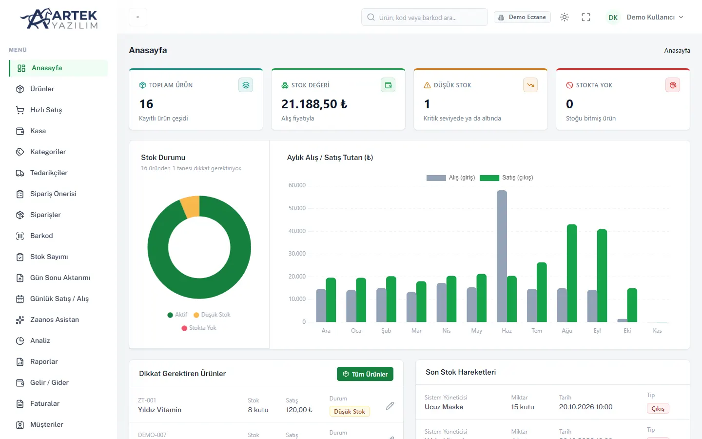
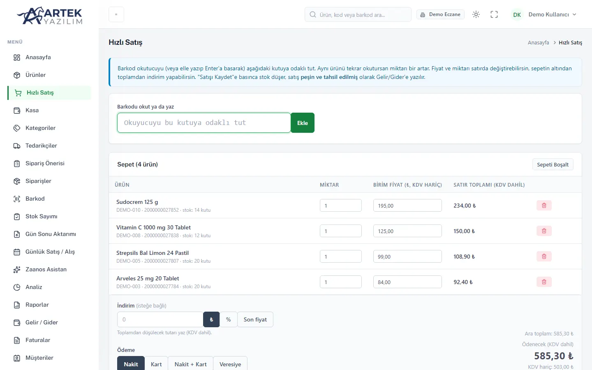
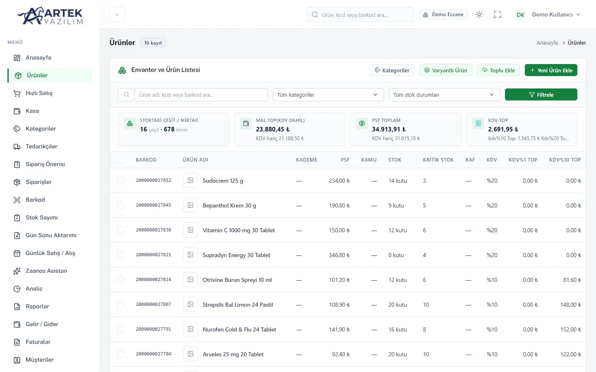
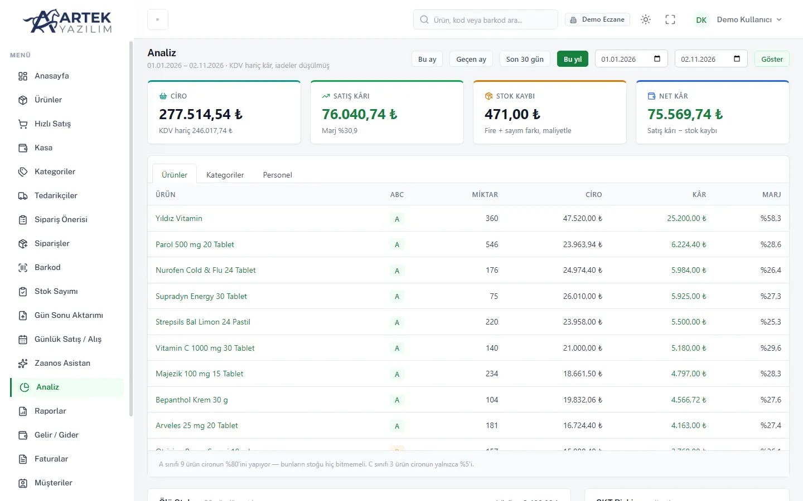
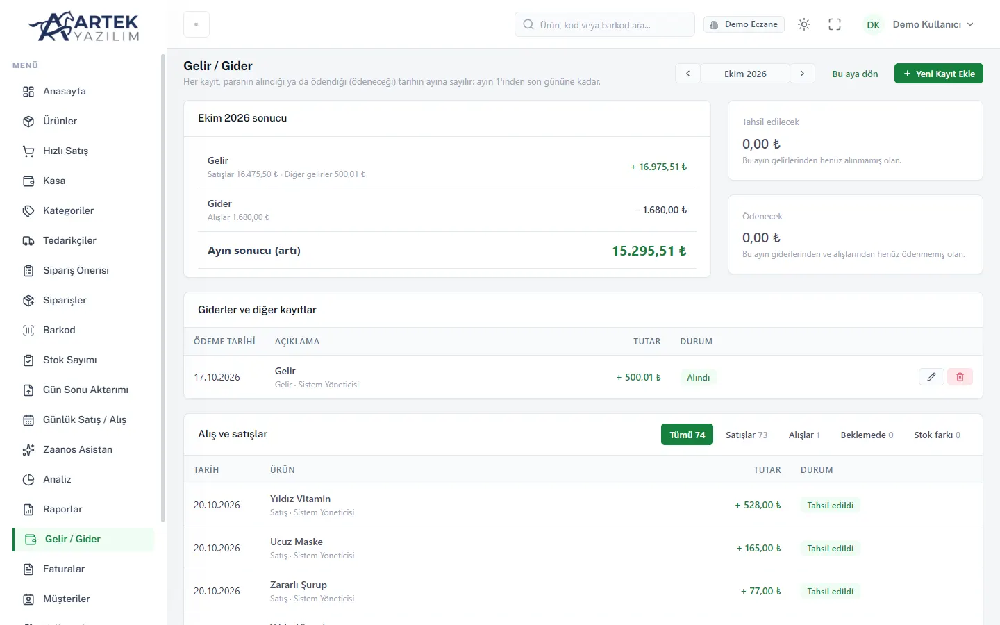

  

### Rafta kaç tane kaldı? Bu ay kâr ettik mi? Hangi ürünün tarihi geçiyor?
**Stok Kontrol bu soruların cevabını tek bakışta verir.**

Eczane, market, dükkan ve depolar için stok, satış, kasa ve gelir-gider yazılımı.

 

&nbsp;

Kart bilgisi gerekmez · Otomatik ücret alınmaz · Kurulum yok · Bilgisayar, tablet ve telefondan çalışır

  

 

<table>
<tr>
<td width="46%">

### 🛒 Barkodu okutun, satış bitsin.

Ürün okutulunca sepete düşer, ödeme şeklini seçip satışı tamamlarsınız.

- Aynı ürünü tekrar okutunca adet artar
- Nakit, kart, nakit + kart ya da veresiye
- İndirim sınırı aşılırsa yönetici onayı ister

</td>
<td></td>
</tr>
<tr>
<td></td>
<td>

### 📦 Bütün ürünleriniz tek listede.

Barkod, fiyat, stok, kritik stok ve KDV aynı tabloda.

- Renk, beden gibi varyantlar; koli ve paket birimleri
- Mevcut listenizi Excel'den tek seferde aktarın
- Birden fazla depo ve kategori

</td>
</tr>
<tr>
<td>

### 📈 Hangi ürün kazandırıyor?

Ciro, kâr ve marjı ürün ürün görün; parayı bağlayan ürünleri fark edin.

- ABC sınıflaması: cironun çoğunu yapan ürünler
- 90 gündür satılmayan ölü stok listesi
- Son kullanma tarihi riski tek kartta

</td>
<td></td>
</tr>
<tr>
<td></td>
<td>

### 💰 Ay sonunda sürpriz yok.

Vadeli alış ve satışlar ödeme tarihinin ayına yazılır; ayın gerçek sonucunu görürsünüz.

- Kira, muhasebe, Bağ-Kur gibi tekrarlayan giderler
- Ödeme günü yaklaşınca anasayfada uyarı
- Kasa, veresiye ve tedarikçi borçları

</td>
</tr>
</table>

 

## ✨ Zaanos: işletmenizi tanıyan yapay zekâ danışmanı

Rapor okumakla uğraşmayın, Türkçe sorun. Zaanos satış, stok ve kâr verinize bakarak cevap verir.

**"Bu ay en çok ne kazandırdı?"** &nbsp;·&nbsp; **"Neyi sipariş etmeliyim?"** &nbsp;·&nbsp; **"Rafta para bağlayan ürün var mı?"**

 

## Ve dahası

| ⏰ Son kullanma tarihi | 🧮 Stok sayımı | 🔄 Gün sonu aktarımı |
|:---:|:---:|:---:|
| Tarihi yaklaşanlar önceden listelenir | Farkları tek tıkla düzeltin | Başka programın dökümüyle stoğu karşılaştırın |
| **🚚 Sipariş önerisi** | **👥 Ekip ve yetkiler** | **🏷️ Barkod etiketi** |
| Azalan ürünler tedarikçiye göre listelenir | Her çalışan kendi hesabı ve rolüyle girer | Etiketleri uygulamadan yazdırın |

 

## Paketler

| | Başlangıç | ⭐ Standart | Kurumsal |
|:---|:---:|:---:|:---:|
| **Aylık (KDV dahil)** | **₺499** | **₺899** | **₺1.499** |
| Kullanıcı | 2 | 5 | Sınırsız |
| Zaanos asistan | — | Günde 20 soru | Günde 60 soru |

 

### Önce deneyin, beğenirseniz devam edin.

  

Ekran görüntülerindeki veriler örnektir. © ARTEK Yazılım

